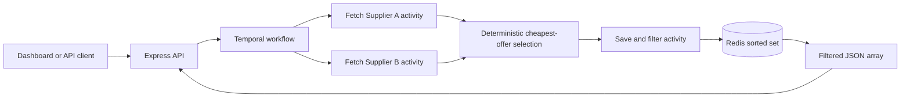

# Staywise · Hotel Offer Orchestrator

[](https://github.com/jaideepug23/hotel-offer-orchestrator/actions/workflows/ci.yml)

A working hotel comparison backend and reviewer dashboard built with **Node.js, TypeScript, Express, Temporal, Redis, and Docker Compose**. Every successful search runs a real Temporal workflow, calls both mock suppliers in parallel, chooses the cheapest offer for each normalized hotel name, saves **all** winners in Redis, and applies the requested price bounds **inside Redis**.

**Live demo:** https://hotel-offer-orchestrator-g9vu.onrender.com

**Live API:** https://hotel-offer-orchestrator-g9vu.onrender.com/api/hotels?city=delhi&minPrice=5340&maxPrice=5900

See [verification evidence](docs/VERIFICATION.md) and the [five-minute reviewer walkthrough](docs/REVIEWER-WALKTHROUGH.md). The GitHub repository is private; grant evaluator access before submission.

## Run the full system

Prerequisites: Docker Engine/Desktop with Compose v2. No Node installation or API keys needed for the containerized application.

```bash
docker compose up --build -d --wait --wait-timeout 240
```

- **Reviewer dashboard:** http://localhost:3000
- **API:** http://localhost:3000/api/hotels?city=delhi
- **Health:** http://localhost:3000/health
- **OpenAPI 3.0 specification:** http://localhost:3000/openapi.json
- **Temporal execution history:** http://localhost:8080

The first start downloads images and initializes Temporal's PostgreSQL schemas. The API liveness check can become ready before the worker finishes starting; `/health` reports full readiness. All host ports bind to loopback by default. PostgreSQL is never published to the host.

```bash
docker compose logs -f api worker
docker compose down       # Stops services; preserves named data volumes
```

## Exact assessment behavior

```bash
curl 'http://localhost:3000/api/hotels?city=delhi&minPrice=5340&maxPrice=5900'
```

```json
[
  { "name": "Holtin", "price": 5340, "supplier": "Supplier B", "commissionPct": 20 },
  { "name": "Radison", "price": 5900, "supplier": "Supplier A", "commissionPct": 13 }
]
```

Unfiltered Delhi returns five hotels: City Garden (3200, A), Lotus Palace (4500, B), Holtin (5340, B), Radison (5900, A), and The Imperial (12000, A). Mumbai returns two; Bengaluru returns one. An unknown city such as `atlantis` returns `[]` with HTTP 200.

Prices are INR. Bounds are inclusive and independently optional. Zero is valid. Negative prices, more than two decimal places, scientific notation, non-numeric values, duplicate parameters, unknown parameters, and reversed bounds return HTTP 400. Names and cities are normalized using Unicode NFKC, trimmed/collapsed whitespace, and lowercase comparison. The selected offer preserves the winning supplier's display name and commission. Commission does not affect the cheapest-price decision. Equal prices deterministically prefer Supplier A.

## Architecture



1. Express validates input before starting a workflow. Each request receives `X-Request-Id` and `X-Workflow-Id` headers.
2. `hotelOffersWorkflow` schedules both supplier activities with `Promise.all`. HTTP and Redis I/O only occur in activities, keeping workflow replay deterministic.
3. The pure selector deduplicates by normalized hotel name, including duplicate names within a single supplier.
4. A Redis Lua script atomically replaces the complete city sorted set and executes `ZRANGE ... BYSCORE`. A filtered response never replaces the complete stored inventory with a subset.
5. Both Redis keys have a 300-second default TTL. A count key records zero-result searches because Redis removes empty sorted sets. Hash tags place both keys in one cluster slot. The script's atomicity prevents concurrent requests from querying another request's intervening snapshot.

Redis keys for Delhi: `hotel-offers:{delhi}:prices` and `hotel-offers:{delhi}:count`. The latest completed comparison replaces the previous snapshot. Every search refreshes suppliers through Temporal; TTL storage is not used to bypass orchestration.

```bash
docker compose exec redis redis-cli ZRANGE 'hotel-offers:{delhi}:prices' 5340 5900 BYSCORE
docker compose exec redis redis-cli ZCARD 'hotel-offers:{delhi}:prices'
```

The second command remains `5` after a filtered Delhi search.

## Reliability and failure semantics

- **Retries:** up to three activity attempts with exponential backoff, 3-second default supplier HTTP timeout, 7-second attempt timeout, 25-second activity schedule limit, and 35-second workflow execution limit. The API also bounds its Temporal RPC context to 38 seconds.
- **Honest comparison:** persistent supplier failure produces HTTP 503, never an unmarked partial result that claims to be the best price. Invalid supplier payloads are non-retryable. Successful empty inventories are valid.
- **Atomic, idempotent writes:** activity retries replace a city snapshot safely; no append-only duplicate accumulation.
- **Health:** `/health` probes both supplier health endpoints, Redis, Temporal, and recent workflow-worker polling concurrently. Returns 200 when healthy, 503 when degraded. Worker polling is a bounded freshness indicator (60 seconds), not a guarantee that a process cannot fail immediately afterward.
- **Liveness:** `/live` only verifies the HTTP process. Deployment health probes use it to avoid circular startup dependencies.
- **Operations:** structured logs, correlation IDs, bounded request admission (40 concurrent comparisons per API process), security headers, non-root containers, prebundled workflows, graceful shutdown, PostgreSQL-backed Temporal history and Redis AOF persistence in Compose.
- **Scope:** deterministic mock inventory, no real reservations, payments, or authentication. Public demo endpoints are read-only. The admission limit is not a distributed abuse-prevention system; put a rate-limiting reverse proxy in front of a production deployment.

## Test the system

Node 22+ is required to run the developer test commands.

```bash
npm ci
npm run typecheck
npm test
npm run build
npm run test:e2e       # Full Compose stack must be running
```

`npm run test:integration` requires a disposable Redis database (`TEST_REDIS_URL`, default `redis://127.0.0.1:6379/15`). It starts a real local Temporal test server using the official SDK, and downloads the official Temporal CLI if needed. Integration tests cover parallel scheduling from actual workflow history, replay, Redis persistence and inclusive filtering, unknown cities, transient recovery, supplier downtime, invalid supplier payloads, atomic concurrent writes, and TTL expiry. Tests only delete their own named fixture keys in the selected Redis database.

GitHub Actions runs type checks, unit/API tests, the real-service integration suite, production dependency audit, and Docker Compose smoke tests. The Compose job also disables and restores Supplier B and restarts the worker before rerunning the API checks. The browser dashboard is a client of the same API; it does not implement a replacement comparison backend.

### Postman

Import `postman/Hotel-Offer-Orchestrator.postman_collection.json`, set `baseUrl`, and run all requests. Assertions verify the expected winners, boundaries, unknown city, validation and health. A separate optional `Supplier-Outage.postman_collection.json` expects Supplier B to be disabled, so ordinary collection runs remain green.

### Simulate an outage

Set `SUPPLIER_B_DOWN=true` in a `.env` file at the repository root, then:

```bash
docker compose up -d --no-deps --force-recreate api
curl -i 'http://localhost:3000/api/hotels?city=delhi'
curl -i http://localhost:3000/health
```

The comparison returns 503 after retries. Health identifies Supplier B as down. Change the value back to `false` and recreate `api` to recover. No public endpoint changes the outage flag.

## Deploy

### Free reviewer demo on Render

Use `render.yaml` or create a free Docker web service from this repository with Dockerfile path **`Dockerfile.demo`** and health path **`/live`**. That image includes real Redis, the official Temporal development server, the API, and the worker. Only the HTTP port is exposed. The Temporal binary is version-pinned and SHA-256 verified. The startup script waits for dependencies and terminates the group if any child exits.

The free demo intentionally uses ephemeral storage: data/history may disappear on redeploy or platform restart, and idle instances may sleep. It is an assessment demo, not a production durability claim. Warm the URL before presenting. A cold start can take longer than a normal API request. The separate Compose deployment uses persistent PostgreSQL and Redis volumes.

### Persistent deployment

Run the Compose stack on a Docker-capable Linux host. Replace the development-only PostgreSQL password, keep Redis/PostgreSQL/Temporal and the Temporal UI private, back up volumes, and put the API behind HTTPS and access controls appropriate to the audience. Bind the API only to your reverse proxy's interface. Temporal Cloud or a managed Temporal cluster can replace the Compose server; add TLS/authentication configuration to both clients before connecting to a secured cluster. Those credentials are deliberately not fabricated or included here.

### Local Node development

Start `postgres`, `temporal`, and `redis` with Compose. Copy `.env.example` to `.env`, then use two terminals:

```bash
node --env-file=.env --import tsx src/server.ts
node --env-file=.env --import tsx src/worker.ts
```

## Assessment checklist

| Requirement | Implementation |
|---|---|
| TypeScript + Express | `src/app.ts`, `src/server.ts` |
| Two mock supplier APIs with overlaps | `src/fixtures.ts`, `/supplierA/hotels`, `/supplierB/hotels` |
| Parallel Temporal orchestration | `src/workflows.ts`, `src/activities.ts` |
| Name deduplication and cheapest offer | `src/domain.ts` |
| Required JSON response shape | `src/types.ts`, API contract tests |
| Save winners and filter in Redis | `src/redis-store.ts` atomic sorted-set query |
| Docker and Compose | `Dockerfile`, `compose.yaml` |
| Setup and deployment documentation | This README, `render.yaml`, `Dockerfile.demo` |
| Postman collection | `postman/` |
| Health of both suppliers | `/health`, `/supplierA/health`, `/supplierB/health` |
| Workflow/activity logging and errors | Temporal activity/workflow logs, structured HTTP logs |
| Extras | Reviewer dashboard, OpenAPI, replay tests, fault injection, CI, exact boundary tests |

## Design limits worth explaining in review

Deduplication by name follows the brief; real hotel integrations should use canonical property IDs to distinguish separate properties with the same name. All fixture prices use one currency and represent comparable offers. Redis writes are atomic per city, but the mock suppliers do not offer a common transactional inventory snapshot. For large real inventories, paginate supplier responses and bound Temporal payload sizes; the current validator caps each supplier at 10,000 rows. External suppliers also need real authentication, quotas, circuit breakers and observability appropriate to their contracts.

Reference documentation: [Temporal TypeScript](https://docs.temporal.io/develop/typescript), [Redis ZRANGE](https://redis.io/docs/latest/commands/zrange/), [Render free services](https://render.com/docs/free).
